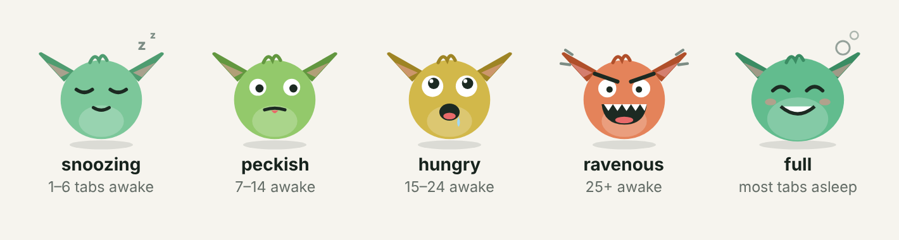

# Tab Goblin

A goblin eats the tabs you ignored. It puts them to sleep without closing them, and can bring them back.

> You have 47 tabs open, the laptop fan is screaming, and you're scared to close any of them. The goblin clears the mess without losing anything you need.



---

## What it does

| Feature | How it works |
|---|---|
| **Tab count and a goblin whose mood changes** | The more tabs are awake and using memory, the hungrier the goblin gets: *snoozing* (1–6 awake), *peckish* (7–14), *hungry* (15–24), *ravenous* (25+). Once most tabs are asleep it's *full*. The toolbar badge shows your tab count, in the goblin's mood colour. |
| **Tabs listed by how long they've been ignored** | Awake tabs are sorted longest-ignored first ("4 days ignored"), with sleeping tabs below. A search box finds any tab. "Ignored" counts from when you last *left* the tab, not when you opened it. |
| **Sleep without closing** | Uses Chrome's own tab discard: the tab stays in your tab strip with its title and icon, but its memory is freed. **Feed the goblin** puts every tab ignored longer than your chosen time (15 minutes by default) to sleep. The moon button puts a single tab to sleep. |
| **A Keep list the goblin never touches** | Tap the shield next to any tab to keep that site (e.g. `mail.google.com`), or add sites under *Keep & settings*. |
| **Save a session and restore it** | **Save session** stores every tab in every window, with a name. **Restore** reopens them in new windows. By default only the first tab loads and the rest open asleep, so restoring 40 tabs is instant. The goblin also autosaves every 5 minutes and keeps a copy of what was open when Chrome last closed. |

**The goblin never eats:**
- the tab you're looking at,
- sites on your Keep list,
- pinned tabs (you can switch this off),
- tabs playing sound,
- **tabs with a half-filled form**. If you typed something into a field and haven't sent it, the tab stays awake. Once you send the form, or clear the field yourself, the tab can sleep again.

Everything is stored in Chrome on your computer. There is no account and no server, and the extension makes no network requests of its own.

---

## Install it (step by step)

You need Google Chrome (or Edge, Brave or any Chromium browser).

1. **Get the folder.** Download `tab-goblin.zip` and unzip it. You should see a folder named `tab-goblin` with a file called `manifest.json` inside.
   - Keep this folder somewhere permanent, like `Documents`. Chrome loads the extension from it every time it starts.
2. **Open the extensions page.** Type `chrome://extensions` in the address bar and press Enter.
3. **Turn on Developer mode** with the switch in the top-right corner.
4. **Click Load unpacked** (top-left) and choose the `tab-goblin` folder, the one that contains `manifest.json`.
5. **Pin it.** Click the puzzle-piece icon in the toolbar, then the pin next to **Tab Goblin**. The goblin's face and your tab count now sit in the toolbar.
6. **Click the goblin.** That's it.

Chrome will say the extension can "read and change all your data on all websites". It needs this for one job only: checking whether a page has a half-filled form before putting it to sleep. It reads nothing else and sends nothing anywhere; the code that does this check is `content/form-guard.js` (a short file you can read).

**To see it bigger:** right-click the goblin → **Options** opens the same view as a full page.
**To update** after changing the code: click the circular arrow on its card in `chrome://extensions`.

---

## How to use it

1. **Click the goblin** to see every tab, longest ignored first.
2. **Press Feed the goblin.** The button tells you how many tabs it will eat. Sleeping tabs turn grey and show *Zzz*.
3. **Click any tab in the list** to jump to it. If it's asleep, Chrome wakes it and reloads the page. Clicking a sleeping tab in Chrome's own tab strip wakes it the same way.
4. **Before a big clean-up, press Save session.** Find it later under *Sessions* and press **Restore**.
5. **Under Keep & settings**, choose how long a tab must be ignored before it gets eaten (5 minutes to 1 day), and turn on *Let it eat on its own* if you want it to clean up every 5 minutes without asking.

---

## Done when: checked

| Check | Result |
|---|---|
| Handles 30 open tabs smoothly | Tested with 32 tabs: the list, including a form check of every tab, came back in under 0.1 s, and one Feed put 29 tabs to sleep in about a second. |
| A half-filled form is never lost | Typed a name and a message into a form, then fed the goblin. The tab was left awake, the toast said *"Left 1 with a half-filled form alone"*, the moon button refused it, and the typed text was still there. After submitting the form, the same tab could sleep. A field typed into and then erased does **not** block sleep. |
| A saved session restores after a Chrome restart | Saved 32 tabs, fully quit Chrome, started it again. The session was still listed; Restore brought back all 32 sites, with 31 asleep and ready. |
| Sleeping tabs wake correctly when clicked | Clicked a sleeping tab in the goblin's list: it became the active tab, reloaded, and showed its page and title again. Also checked on a tab that was restored asleep. |

Automated test run: **26 of 26 checks passed** in real Chromium (32 local test sites, extension loaded unpacked, Chrome restarted mid-test).

---

## Files

```
tab-goblin/
├── manifest.json          Chrome extension settings (Manifest V3)
├── shared.js              Moods, time labels, settings defaults
├── background.js          Tracks ignored time, sleeps/wakes tabs, sessions, autosave, badge
├── content/
│   └── form-guard.js      Notices fields you typed into but haven't sent
├── popup/
│   ├── popup.html/.css/.js  The goblin, tab list, sessions, Keep & settings
│   └── goblin.js          The goblin, drawn as SVG (one face per mood)
├── icons/
└── screenshots/
```

### How it is built

- **"Ignored for":** the background worker listens for tab switches. When you leave a tab it writes down the time, in `chrome.storage.session` (cleared when Chrome closes, because tab IDs change). Tabs it hasn't seen yet fall back to Chrome's own `lastAccessed` time.
- **Sleeping** is `chrome.tabs.discard()`: Chrome's built-in way of freeing a tab's memory while keeping it in the tab strip. Waking is just switching to the tab, which makes Chrome reload it.
- **Form check:** `form-guard.js` runs in every page and frame. It remembers what each field held when you first clicked into it. Before eating a tab, the goblin asks every frame of that page whether any field you touched still holds new, unsent text. Pages opened before the goblin was installed are checked by comparing each field with its original value. Pages that don't answer within 1.5 s are left alone, to be safe.
- **Sessions** are plain lists of URLs, titles and pinned state per window, saved with `chrome.storage.local`, so they survive restarts. The 5-minute autosave and the "When Chrome last closed" copy use `chrome.alarms` and Chrome's startup event.

### Permissions

| Permission | Why |
|---|---|
| `tabs` | To list tab titles and addresses and switch between them |
| `storage` | To save your Keep list, settings and sessions |
| `alarms` | For autosave and *Let it eat on its own* |
| `scripting` + access to all sites | Only to ask a page "is there a half-filled form here?" before sleeping it |
| `favicon` | To show each site's icon in the list without loading anything from the internet |

### Known limits

- Chrome doesn't let extensions look inside its own pages (`chrome://…`, the Web Store), so those can't be form-checked or added to the Keep list. They never hold forms you've typed into.
- Text typed into some complex web editors that don't use normal form fields may not be noticed. Add those sites to your Keep list if you rely on them.
